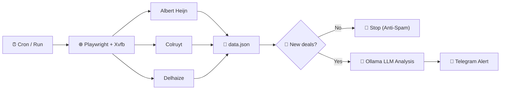

# 🥊 Local AI Promo-Agent (Dendermonde)

A 100% local, autonomous AI agent that scrapes Belgian supermarkets (**Albert Heijn**, **Colruyt / Collect&Go**, **Delhaize**) every week for promotions on high-protein sports nutrition (such as *HiPRO, Barebells, Holie's, Upfront, Melkunie Protein, Nākd Protein*), calculates effective unit prices using a local LLM via **Ollama** (`qwen3-coder:30b`), and sends a clean, grouped summary via **Telegram** whenever **new or better deals** appear.

---

## 🏗️ Architecture & Dataflow



---

## ✨ Current Status

- **WAF-Free Multi-Store Scraper (`extract_supermarkets.py`):**
  - Connects via Playwright CDP (`http://localhost:9222`) to a real `google-chrome-stable` instance with a persistent user profile (`~/.config/chrome-ah-profile`), running on a virtual display (`xvfb-run`).
  - Uses accessibility attributes (`data-testid`, `aria-label`, `.sr-only`) to build a uniform `semantic_context` for each product (always starting with `PROMO_ACTIVE: <deal>` or `NO_PROMO (standard price)`).
- **Smart Deal-Level Memory (`seen_promos.json`):**
  - Stores a deterministic SHA-256 hash of `supermarket | title | promotion | unit_price` for every active deal.
  - **No new deals = No spam:** If all currently active promotions were already notified in a previous run, the script exits immediately without calling Ollama or spamming Telegram.
  - **New deal or price drop:** As soon as at least one new deal appears, the bot sends the full overview marking new deals with `🆕` and ongoing deals with `(still running)`.
  - **Automatic pruning:** When a promotion ends at a store, it is automatically removed from `seen_promos.json`. When the same deal returns weeks later, it is treated as `🆕` again.
- **2-Stage Local LLM Map-Reduce (`analyze_promos.py`):**
  - Runs locally on **Ollama** (`qwen3-coder:30b` on RTX 5080, `temperature: 0.0`).
  - Filters strictly for major promotions (>= 50% effective discount per item, such as `1+1 free`, `2nd free`, `-50%`), calculates effective per-item promo prices (`0.50 * unit_price`), and merges different flavors/variants of the same brand onto a single bullet line.
- **Personal Agent Skill Ready (`search_on_demand.py` & `skills/supermarket-promos/SKILL.md`):**
  - Can be invoked on demand by a local Personal Agent (**Hermes Agent**, **OpenClaw**, or **Antigravity**) for arbitrary products and stores without touching the weekly cron state.

---

## 📂 File Structure

| File | Description |
| :--- | :--- |
| `run_agent.sh` | Master script: loads `.env`, starts Xvfb + Chrome, runs the scraper, and executes the promo analyzer. |
| `extract_supermarkets.py` | Playwright CDP scraper for Albert Heijn, Colruyt, and Delhaize. Writes results to `data.json`. |
| `analyze_promos.py` | Compares `data.json` against `seen_promos.json`, runs the 2-stage Ollama analysis, and sends the Telegram alert. |
| `search_on_demand.py` | On-demand CLI wrapper (reuses `extract_supermarkets.py` and `analyze_promos.py`) for live product/promo queries without overwriting `data.json`. |
| `skills/supermarket-promos/SKILL.md` | Standardized Agent Skill (`SKILL.md`) for integration with **Hermes Agent**, **OpenClaw**, or **Antigravity**. |
| `start_browser.sh` | Helper script to launch Chrome **visibly** (useful for saving initial cookies/sessions in the profile). |
| `start_browser_xvfb.sh` | Helper script to launch Chrome in the background under `Xvfb`. |
| `.env.example` | Template for required environment variables (`TELEGRAM_BOT_TOKEN`, `TELEGRAM_CHAT_ID`, `OLLAMA_URL`, `OLLAMA_MODEL`). |
| `project_plan.md` | Project background, architecture decisions, and Phase 2 Personal Agent integration notes. |

*(Files such as `.env`, `data.json`, `seen_promos.json`, `last_message.json`, and `agent_log.txt` are generated locally at runtime and excluded via `.gitignore`.)*

---

## 🚀 Installation & Configuration

### 1. Requirements
- **OS:** Ubuntu (with `google-chrome-stable` and `xvfb` installed)
- **Ollama:** Running locally on port `11434` with `qwen3-coder:30b` (`ollama pull qwen3-coder:30b`)
- **Python 3.12+** with virtual environment (`venv`)

```bash
python3 -m venv venv
./venv/bin/pip install playwright requests
```

### 2. Environment Variables (`.env`)
Copy `.env.example` to `.env` and fill in your Telegram credentials:

```bash
cp .env.example .env
chmod 600 .env
```

Contents of `.env`:
```env
TELEGRAM_BOT_TOKEN="your_telegram_bot_token_here"
TELEGRAM_CHAT_ID="your_telegram_chat_id_here"
OLLAMA_URL="http://localhost:11434/api/generate"
OLLAMA_MODEL="qwen3-coder:30b"
```

---

## 🛠️ Usage

### Full Pipeline (Scrape + Analyze + Telegram)
```bash
./run_agent.sh
```

### Scrape Only (with quick test mode)
Start the browser first (visible via `./start_browser.sh` or invisible via `./start_browser_xvfb.sh`):
```bash
# Full scrape across all brands and supermarkets:
./venv/bin/python extract_supermarkets.py

# Quick test scrape (only hipro, barebells, eiwitreep):
./venv/bin/python extract_supermarkets.py --quick
```

### Analyze Only (using existing `data.json`)
```bash
# Normal run (only sends to Telegram when new/changed deals are found):
./venv/bin/python analyze_promos.py

# Dry-run (prints the Ollama message in the terminal without sending to Telegram or updating seen_promos.json):
./venv/bin/python analyze_promos.py --dry-run

# Force-run (always sends the overview to Telegram, even if there are no new deals):
./venv/bin/python analyze_promos.py --force
```

### Automated Weekly Cron Job
The agent runs automatically every Wednesday at 09:00 AM via `crontab -e`:
```cron
0 9 * * 3 /home/bavobbr/projects/proteine-agent/run_agent.sh >> /home/bavobbr/projects/proteine-agent/agent_log.txt 2>&1
```

### On-Demand Search (CLI & Personal Agent Skill)
Use `search_on_demand.py` (manually or via **Hermes Agent** / **OpenClaw**) to search live for any product across specific supermarkets without touching `data.json` or `seen_promos.json`:

```bash
# Scan the default protein watchlist for active promotions across all stores:
./venv/bin/python search_on_demand.py --only-promos

# Search for 'skyr' at Delhaize and Colruyt:
./venv/bin/python search_on_demand.py --queries "skyr" --stores "delhaize,colruyt"

# Search only active promotions for chicken breast or peanut butter across all stores:
./venv/bin/python search_on_demand.py --queries "kipfilet,pindakaas" --only-promos
```

The Agent Skill is located at `skills/supermarket-promos/SKILL.md` and can be linked directly into Hermes Agent:
```bash
mkdir -p ~/.hermes/skills
ln -s /home/bavobbr/projects/proteine-agent/skills/supermarket-promos ~/.hermes/skills/supermarket-promos
```
