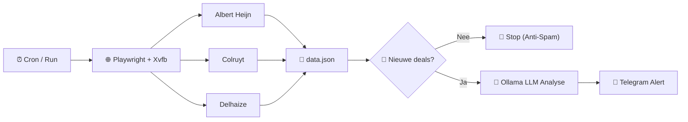

# 🥊 Lokale AI Promo-Agent (Dendermonde)

Een 100% lokale, autonome AI-agent die wekelijks Belgische supermarkten (**Albert Heijn**, **Colruyt / Collect&Go**, **Delhaize**) doorzoekt op promoties voor eiwitrijke sportvoeding (zoals *HiPRO, Barebells, Holie's, Upfront, Melkunie Protein, Nākd Protein*), de actieprijzen per stuk doorrekent met een lokaal LLM via **Ollama** (`qwen3-coder:30b`), en enkel bij **nieuwe of scherpere deals** een overzichtelijk bericht stuurt via **Telegram**.

---

## 🏗️ Architectuur & Dataflow



---

## ✨ Huidige Status (Deel 1 — Voltooid)

- **WAF-vrije Multi-Store Scraper (`extract_supermarkten.py`):**
  - Koppelt via Playwright CDP (`http://localhost:9222`) aan een echte `google-chrome-stable` instantie met een persistent profiel (`~/.config/chrome-ah-profile`), draaiend op een virtueel scherm (`xvfb-run`).
  - Gebruikt toegankelijkheidsattributen (`data-testid`, `aria-label`, `.sr-only`) om voor elk product een uniforme `semantische_context` op te bouwen (startend met `PROMOTIE_ACTIEF: <actie>` of `GEEN_PROMOTIE (standaardprijs)`).
- **Slim Deal-Geheugen (`seen_promos.json`):**
  - Bewaart per actieve aanbieding een deterministische SHA-256 hash van `supermarkt | titel | promotie | stukprijs`.
  - **Geen nieuwe deals = Geen spam:** Als alle lopende acties al eerder gemeld zijn, stopt het script direct zonder Ollama te belasten of Telegram te spammen.
  - **Nieuwe deal of prijsdaling:** Zodra er minstens één nieuwe deal is, stuurt de bot het volledige overzicht met `🆕` bij nieuwe deals en `(loopt nog)` bij doorlopende acties.
  - **Automatische opschoning:** Zodra een promotie bij de winkel stopt, verdwijnt deze uit `seen_promos.json`. Keert dezelfde actie weken later terug, dan telt die weer als `🆕`.
- **2-Staps Lokale LLM Map-Reduce (`analyseer_promos.py`):**
  - Draait lokaal op **Ollama** (`qwen3-coder:30b` op RTX 5080, `temperature: 0.0`).
  - Rekent promoties om naar de effectieve prijs per stuk (`1+1 gratis` = `0.50x`, `2de tegen -50%` = `0.75x`, `-25% vanaf 2 st` = `0.75x`, enz.) en groepeert verschillende smaken/varianten van hetzelfde merk op één enkele regel.

---

## 📂 Bestandsstructuur

| Bestand | Beschrijving |
| :--- | :--- |
| `run_agent.sh` | Hoofdscript: laadt `.env`, start Xvfb + Chrome, draait de scraper en vervolgens de promo-analyse. |
| `extract_supermarkten.py` | Playwright CDP-scraper voor Albert Heijn, Colruyt en Delhaize. Schrijft resultaten naar `data.json`. |
| `analyseer_promos.py` | Vergelijkt `data.json` met `seen_promos.json`, voert de 2-traps Ollama-analyse uit en stuurt het Telegram-bericht. |
| `start_browser.sh` | Hulpscript om Chrome **zichtbaar** te starten (handig om eenmalig cookies/sessies in het profiel op te slaan). |
| `start_browser_xvfb.sh` | Hulpscript om Chrome los op de achtergrond in `Xvfb` te starten. |
| `.env.example` | Sjabloon voor de benodigde omgevingsvariabelen (`TELEGRAM_BOT_TOKEN`, `TELEGRAM_CHAT_ID`, `OLLAMA_URL`, `OLLAMA_MODEL`). |
| `projectplan_promo_agent.md` | Achtergrond, architectuurkeuzes en roadmap voor Deel 2. |

*(Bestanden zoals `.env`, `data.json`, `seen_promos.json`, `laatste_bericht.json` en `agent_log.txt` worden lokaal gegenereerd en staan in `.gitignore`.)*

---

## 🚀 Installatie & Configuratie

### 1. Vereisten
- **OS:** Ubuntu (met `google-chrome-stable` en `xvfb` geïnstalleerd)
- **Ollama:** Lokaal actief op poort `11434` met het model `qwen3-coder:30b` (`ollama pull qwen3-coder:30b`)
- **Python 3.12+** met virtuele omgeving (`venv`)

```bash
python3 -m venv venv
./venv/bin/pip install playwright requests
```

### 2. Omgevingsvariabelen (`.env`)
Kopieer `.env.example` naar `.env` en vul je eigen Telegram-gegevens in:

```bash
cp .env.example .env
chmod 600 .env
```

Inhoud van `.env`:
```env
TELEGRAM_BOT_TOKEN="jouw_bot_token_hier"
TELEGRAM_CHAT_ID="jouw_chat_id_hier"
OLLAMA_URL="http://localhost:11434/api/generate"
OLLAMA_MODEL="qwen3-coder:30b"
```

---

## 🛠️ Gebruik

### Volledige Pijplijn (Scrapen + Analyseren + Telegram)
```bash
./run_agent.sh
```

### Enkel Scrapen (met snelle testmodus)
Start eerst de browser (zichtbaar via `./start_browser.sh` of onzichtbaar via `./start_browser_xvfb.sh`):
```bash
# Volledige scrape over alle merken en winkels:
./venv/bin/python extract_supermarkten.py

# Snelle test-scrape (enkel hipro, barebells, eiwitreep):
./venv/bin/python extract_supermarkten.py --quick
```

### Enkel Analyseren (op basis van bestaande `data.json`)
```bash
# Normale run (stuurt enkel naar Telegram bij nieuwe/gewijzigde deals):
./venv/bin/python analyseer_promos.py

# Dry-run (toont het Ollama-bericht in de terminal, stuurt niets naar Telegram en wijzigt seen_promos.json niet):
./venv/bin/python analyseer_promos.py --dry-run

# Force-run (stuurt het overzicht altijd naar Telegram, ook als er geen nieuwe deals zijn):
./venv/bin/python analyseer_promos.py --force
```

### Automatische Wekelijkse Cronjob
De agent draait automatisch elke woensdag om 09:00 uur via `crontab -e`:
```cron
0 9 * * 3 /home/bavobbr/projects/proteine-agent/run_agent.sh >> /home/bavobbr/projects/proteine-agent/agent_log.txt 2>&1
```

---

## 🗺️ Roadmap — Deel 2: Interactieve Personal Promo-Agent
- **On-Demand Zoekopdrachten via Telegram:** Berichten sturen naar de Telegram-bot in natuurlijke taal (bijv. *"Zoek eens of er promo is op skyr of kipfilet bij AH en Colruyt"*), waarna de agent lokaal de intentie extraheert, live de betreffende winkels scrapet en antwoordt in Telegram.
- **Watchlist Beheer via Telegram:** Eenvoudig zoektermen/merken toevoegen aan of verwijderen uit de wekelijkse automatische scan.
